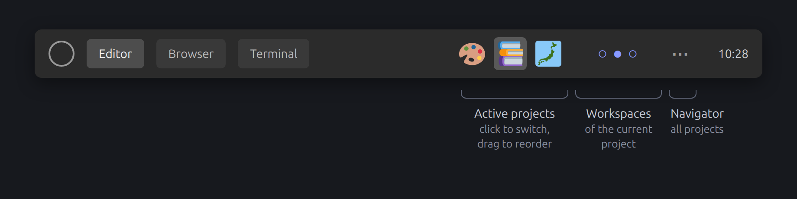
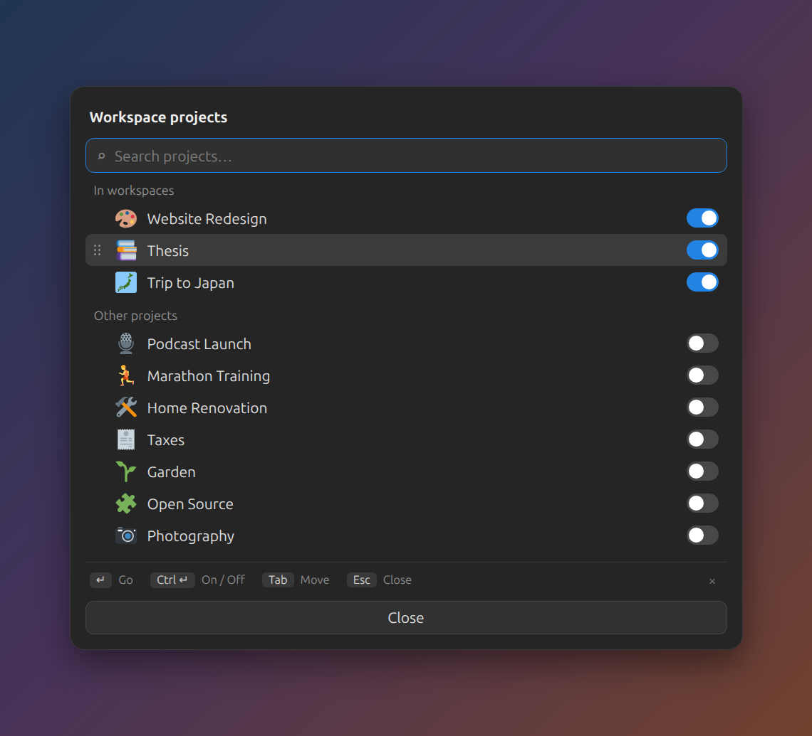
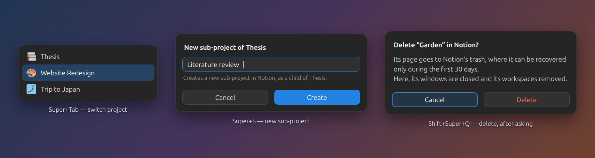

# BetterWorkspaces

A Cinnamon (Linux Mint) panel applet that organizes virtual workspaces by project instead of as one flat row. Each project gets its own strip of workspaces, and the list of projects comes from a Notion database, so the desktop mirrors the projects you are actually working on.

The idea: switching context should mean switching project, not hunting for "workspace 7". You turn a project on, it gets a workspace and an icon in the panel; you move between projects, and between the workspaces inside one, with separate keys.

<p align="center">
  
</p>

*The images on this page are illustrations with sample projects, drawn to match the applet's default look.*

## What it does

- **A project bar in the panel.** One icon per active project (the page icon from Notion), plus dots for the workspaces of the project you are on. Click an icon to go there, drag icons to reorder.
- **Workspaces inside a project.** Step past the last workspace of a project to add one. A workspace you leave empty is removed again, so projects never accumulate dead workspaces.
- **A project navigator (Super+P).** A searchable list of every project in the database. Type a name and press Enter to go to it; a project that was off is turned on first.
- **A project switcher (Super+Tab).** Most-recently-used order, like Alt+Tab but for projects.
- **Two-way Notion sync.** Turning a project on or off, and reordering, is written back to Notion. Projects archived or deleted in Notion leave the panel on the next sync.
- **Create and delete from the desktop.** Create a project or a sub-project (it lands on a new workspace with its Notion page open), or delete one, without opening Notion first.
- **Survives a Cinnamon restart.** Each project keeps its workspaces and windows where they were.

## Requirements

- Linux Mint with Cinnamon. Developed and used daily on Cinnamon 6.4 under X11; other versions are untested.
- A Notion workspace with a projects database (see below) and an internal integration.

## Install

```sh
git clone https://github.com/pedrou2000/BetterWorkspaces.git
cd BetterWorkspaces
./install.sh
```

`install.sh` links the applet folder into `~/.local/share/cinnamon/applets/`. Then restart Cinnamon (Alt+F2, type `r`, Enter) and add **BetterWorkspaces** to a panel from System Settings → Applets.

Because the applet is linked rather than copied, pulling a newer version and restarting Cinnamon is all an update takes.

## Connect Notion

1. Create an internal integration at <https://www.notion.so/my-integrations>. It needs to read, update and insert content.
2. Share your projects database with that integration (the database's ••• menu → Connections). If you use sub-projects, also share the databases its relations point to, or those relations will not be copied.
3. Right-click the applet → Configure, paste the integration token and the database ID, and press "Sync from Notion now".

The database needs these properties. The names are fixed for now (they live in one file, `notion/ProjectMapper.js`).

| Property | Type | Used for |
|---|---|---|
| `Project` | Title | The project's name |
| `Workspace` | Checkbox | Whether the project is on the panel |
| `Workspace Order` | Number | Its position on the panel |
| `Archive` | Checkbox | Archived projects are hidden and leave the panel |
| `Parent` | Relation to the same database | Optional. Set on a new sub-project |
| `Type` | Select | Optional. Copied from the parent to a new sub-project |
| `Areas`, `Lifetime Periods` | Relation | Optional. Copied from the parent to a new sub-project |
| `Current Priority` | Select: Top, High, Medium, Low, Very Low | Optional. Orders the projects that are off in the navigator |

The page icon (emoji, Notion icon or image) becomes the project's icon in the panel.

What the applet writes to Notion, and nothing else:

- the `Workspace` checkbox and `Workspace Order` of existing pages;
- a new page when you create a project, with its name, the two fields above, and for a sub-project its parent and the values copied from it;
- moving a page to Notion's trash when you delete a project, after a confirmation.

## Using it

### Keyboard

These are the defaults; all of them can be changed under Configure → Keyboard shortcuts. While the applet runs it takes these keys over from anything else bound to them.

| Shortcut | Action |
|---|---|
| Super+Left / Super+Right | Previous / next workspace of the current project. Past either end, a workspace is added |
| Super+Alt+Left / Right | Previous / next project |
| Ctrl+Super+Left / Right | Carry the focused window to the previous / next workspace |
| Ctrl+Super+Alt+Left / Right | Carry the focused window to the previous / next project |
| Super+Tab | Project switcher, most recently used first |
| Super+P | Project navigator |
| Super+N | Open the current project's Notion page |
| Super+A | New project |
| Super+S | New sub-project of the current project |
| Super+Q | Remove the current project from the panel |
| Shift+Super+Q | Delete the current project in Notion (asks first) |
| Super+R | Sync with Notion now |

It also reassigns a few of Cinnamon's own window actions: Super+Shift+arrows tile the window, Alt+A maximizes and Alt+S minimizes.

In the navigator: type to filter, Tab or the arrow keys move the highlight, Enter goes to the project, Ctrl+Enter turns it on or off, Escape closes. If nothing matches, a row offers to create a project with that name.

<p align="center">
  
</p>

Switching, creating and deleting each have their own small window:

<p align="center">
  
</p>

### Mouse

- Click a project icon to go to it; double-click to remove it from the panel; drag to reorder.
- Click a dot to go to that workspace of the current project.
- Right-click a project icon (or the dots) for that project's actions; right-click elsewhere for the general ones.
- The ⋯ button opens the navigator. It changes to a warning symbol when Notion is not connected or a sync failed.

### Things worth knowing

- **Removing a project closes its windows.** They are asked to close the normal way, so an application with unsaved work can refuse, and then the project stays. There is no confirmation step for removing; there is one for deleting in Notion.
- **Removing is not deleting.** Removing takes a project off the panel and unticks `Workspace` in Notion. Deleting moves its Notion page to the trash.
- **Offline mostly works.** The applet runs from a local copy of the project list. Turning projects on or off and reordering are sent to Notion once it is reachable again; creating and deleting a project need a connection at that moment.

## Settings

Under Configure you will also find: the sync interval, whether empty workspaces are removed automatically, icon and dot sizes, whether emoji are drawn the way Notion draws them, and the look of the dialogs (a Notion-like dark style with a choice of backgrounds, or Cinnamon's stock dialogs).

## Status and limits

This is a personal project that I use every day, not a packaged product. Before relying on it, know that:

- It expects the database properties listed above, by those names.
- It reads the first 100 projects that are not archived.
- The integration token is stored in plain text in Cinnamon's applet settings.
- It is not on Cinnamon Spices, and there is no mode for people who do not use Notion.

## Development

The applet runs under GJS, Cinnamon's JavaScript runtime, not Node. The logic that does not touch Cinnamon is unit-tested under Node.

```sh
npm install      # or: corepack pnpm@9 install
npm test         # unit tests
npm run check    # formatting, lint and tests; run before committing
```

- `better-workspaces@pedrou2000/` is the applet itself: `core/` (the project and workspace model), `wm/` (the only code that talks to the window manager), `notion/` (the Notion API), `ui/` (panel, navigator, dialogs), `lib/` (helpers).
- `tests/` loads the applet's modules unchanged; see `tests/README.md`.
- Files are GJS scripts: no `import`/`export`, and each module exports through a top-level `var`.

To see applet errors, open Looking Glass (Alt+F2, type `lg`, Enter) and look at the Log tab.

## Credits and license

Licensed under the GNU General Public License, version 2; see `LICENSE`.

Inspired by [workspace-grid@hernejj](https://github.com/linuxmint/cinnamon-spices-applets/tree/master/workspace-grid%40hernejj).

Emoji icons are drawn with [Twemoji](https://github.com/jdecked/twemoji) artwork, downloaded when first needed. Twemoji graphics are licensed under CC-BY 4.0.
